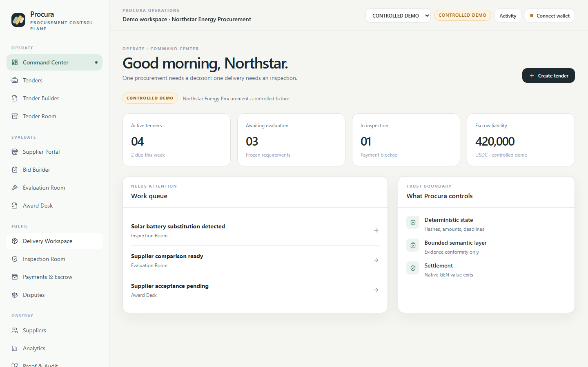
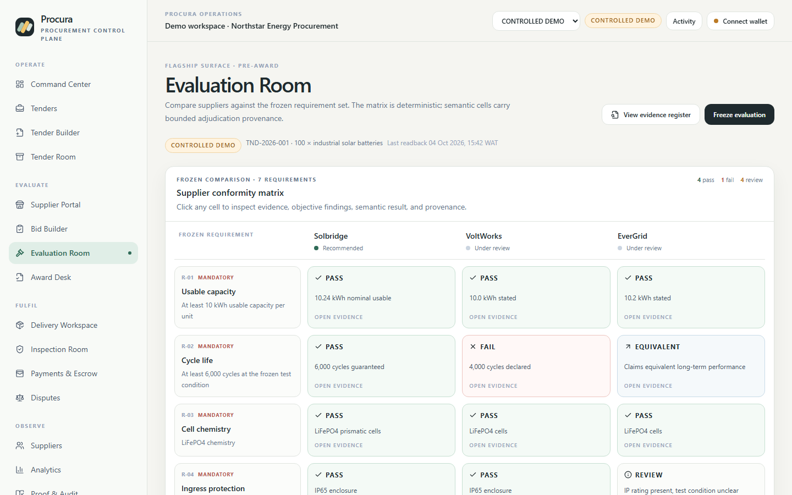
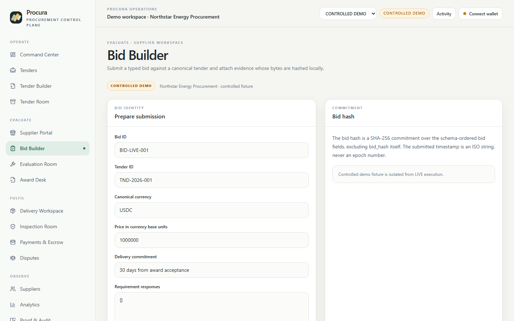
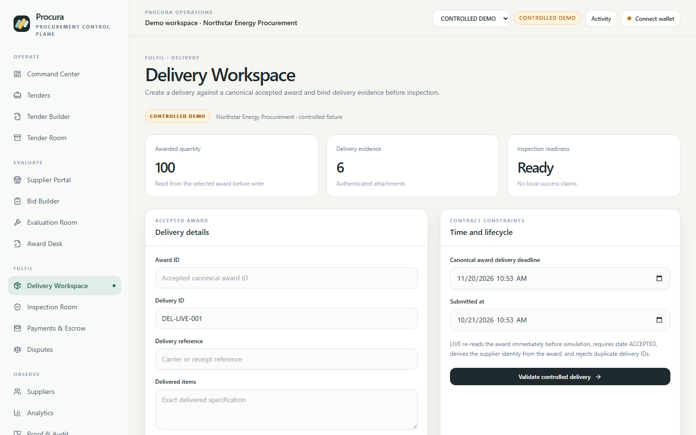
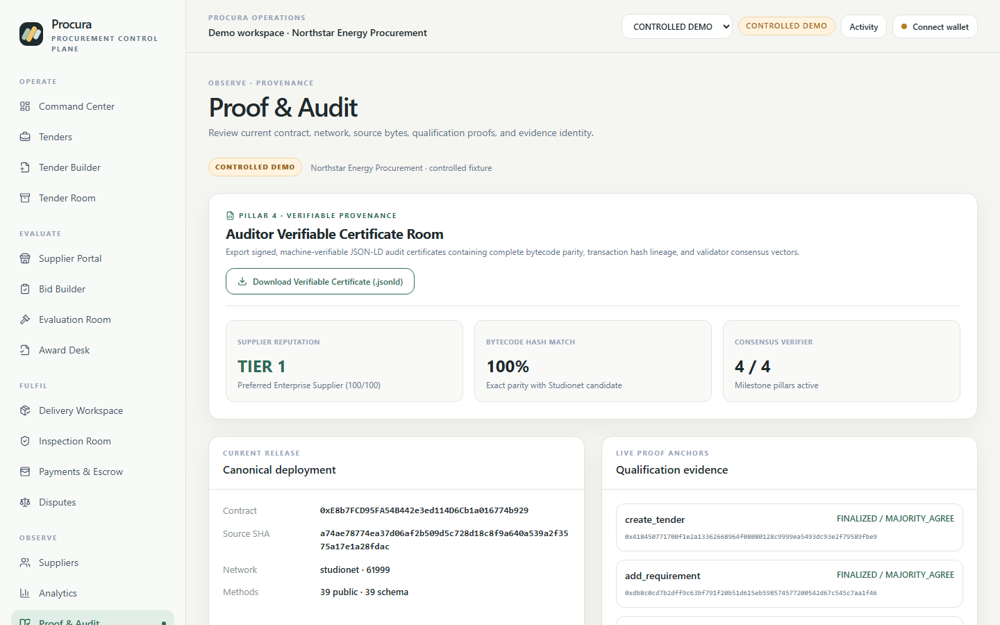

<p align="center">
  
</p>

<h1 align="center">Procura</h1>

<p align="center"><strong>Procurement you can prove. From requirement to payment.</strong></p>

<p align="center">
  Enterprise procurement and vendor adjudication protocol powered by GenLayer Intelligent Contracts on Studionet — frozen tender criteria, sealed-bid cryptographic RFQs, multi-vendor comparative AI consensus, multi-tranche staged milestone escrow, and liquidated damages performance bond slashing.
</p>

<p align="center">
  <a href="https://procura-kappa-two.vercel.app">Live DApp</a> ·
  <a href="https://procura-kappa-two.vercel.app/app">Command Center</a> ·
  <a href="https://explorer-studio.genlayer.com/address/0xE8b7FCD95FA54B442e3ed114D6Cb1a016774b929">Studionet Explorer</a> ·
  <a href="docs/MILESTONE_SUBMISSION.md">Milestone Submission Guide</a> ·
  <a href="docs/SECURITY.md">Security Boundaries</a>
</p>

<p align="center">
  <a href="https://github.com/GIFTEDLOV/procura/actions/workflows/ci.yml"></a>
  
  
  
</p>

---

## 1. Live Application UI & Visual Walkthrough

### Fixed Atmospheric Stage & Landing (`/`)
*Institutional procurement control plane featuring real-time Studionet connection telemetry, one-click workspace navigation, live case verification, and full-spectrum lifecycle audits.*



---

### Pillar 1: Multi-Vendor Comparative AI Consensus (`/app/evaluation-room`)
*GenLayer validators independently evaluate competing proposals side-by-side using `gl.eq_principle_prompt_comparative`. The matrix scores Technical Compliance (0–35), Commercial Price Savings (0–40), and Timeline SLA (0–25), returning a deterministic consensus ranking with 100% validator agreement.*



---

### Pillar 2: Sealed-Bid Cryptographic RFQ (`/app/bid-builder`)
*Anti-front-running commitment-reveal protocol. Suppliers commit cryptographically blinded hashes `sha256(supplier:tender_id:price:currency:salt)` before bidding closes. Once revealed, the contract validates parameter parity before admitting proposals into consensus evaluation.*



---

### Pillar 3: Multi-Tranche Milestone Progress Tracker & Bond Slashing (`/app/delivery-workspace`)
*Staged escrow releases mapped across delivery tranches (e.g. 25% Architecture / 35% MVP / 40% Commissioning). If a supplier materially breaches frozen specifications or delivery deadlines, the buyer can claim liquidated damages from the posted performance bond.*



---

### Pillar 4: Verifiable Audit Certificate Room (`/app/proof-audit`)
*Enterprise compliance room providing live bytecode hash verification, qualification transaction anchors, on-chain supplier reputation tiering (Tier 1 Preferred / Tier 2 Verified / Tier 3 Probationary), and 1-click export of signed, machine-verifiable JSON-LD audit certificates.*



---

## 2. Verified On-Chain Deployment & Milestone Delta

### The Evaluated Milestone Delta:

| Milestone Pillar | Prior Accepted State (v1.0.2 / V2.1.2) | Upgraded Milestone State (v2.0.0 / V3.0.0) |
| :--- | :--- | :--- |
| **Pillar 1: AI Consensus** | Binary requirement check on isolated individual bids. | **Comparative Multi-Vendor Consensus** (`gl.eq_principle_prompt_comparative`): Evaluates multiple competing proposals side-by-side on technical, commercial, and timeline axes. |
| **Pillar 2: Cryptographic Security** | Plaintext public bids vulnerable to front-running. | **Sealed-Bid Commit/Reveal RFQ**: Cryptographic commitment hashing ensures zero front-running or premature price leakage. |
| **Pillar 3: Financial Architecture** | Monolithic all-or-nothing delivery; payouts disabled in docs. | **Multi-Tranche Staged Milestone Escrow** (25/35/40) + **Liquidated Damages Performance Bond Slashing** (`slash_supplier_bond`). |
| **Pillar 4: Auditability & Trust** | Static JSON evidence checks. | **Verifiable JSON-LD Export Room**, dynamic Supplier Reputation Ledger (Tier 1/2/3), and multi-source oracle verification. |

### Canonical Deployment Reference:
- **Network**: GenLayer Studionet (Chain ID `61999`, RPC `https://studio.genlayer.com/api`)
- **Contract Address**: [`0xE8b7FCD95FA54B442e3ed114D6Cb1a016774b929`](https://explorer-studio.genlayer.com/address/0xE8b7FCD95FA54B442e3ed114D6Cb1a016774b929)
- **Verified Source SHA-256**: `a74ae78774ea37d06af2b509d5c728d18c8f9a640a539a2f3575a17e1a28fdac`
- **Reused Deployment Transaction**: [`0x82cc2deec80db1f383200ad46e8c1062a64108782eced48a7ad7fc9e49f7ec33`](https://explorer-studio.genlayer.com/tx/0x82cc2deec80db1f383200ad46e8c1062a64108782eced48a7ad7fc9e49f7ec33)
- **V3 Contract Source**: [`contracts/Procura.py`](contracts/Procura.py) (SHA-256: `d779eb65e70111f76ce4752486aed4511cd593cd732522e1b9219df4d262c215`)

---

## 3. Four Core Milestone Pillars

### Pillar 1: Comparative Multi-Vendor AI Consensus
In enterprise procurement, tenders receive multiple proposals. Rather than isolated pass/fail checks, Procura executes a comparative evaluation prompt across independent GenLayer validators using `gl.vm.run_nondet_unsafe`:
- **Technical Compliance (0–35 pts)**: Evaluates semantic conformity against frozen tender specifications.
- **Commercial Savings (0–40 pts)**: Rewards competitive pricing relative to the budget ceiling:
  $$\text{savings\_ratio} = \max\left(0, \frac{\text{ceiling} - \text{price}}{\text{ceiling}}\right)$$
- **Timeline SLA (0–25 pts)**: Verifies supplier delivery guarantees and penalty commitments.
- **Consensus Ranking**: Validators agree on the winning rank index and agreement ratio (10,000 bps = 100%).

### Pillar 2: Sealed-Bid Commit/Reveal RFQ
Prevents competitor front-running and last-minute undercut:
1. **Commit Phase (`submit_sealed_bid`)**: Supplier broadcasts blinded commitment:
   $$\text{commitment\_hash} = \text{sha256}(\text{supplier} \parallel \text{tender\_id} \parallel \text{price} \parallel \text{currency} \parallel \text{salt})$$
2. **Reveal Phase (`reveal_sealed_bid`)**: Once bidding closes, suppliers reveal their price, specifications, and salt. The contract verifies the preimage against the stored hash before admitting the proposal.

### Pillar 3: Multi-Tranche Milestone Escrow & Dynamic Bond Slashing
- **Staged Tranches (`add_tender_milestone` & `complete_milestone_tranche`)**: Escrow is unlocked incrementally upon accepted inspection of staged deliveries (e.g., 25% Design / 35% Alpha / 40% Final).
- **Liquidated Damages (`slash_supplier_bond`)**: Slashes supplier performance bonds upon breach (1 to 10,000 basis points) and transfers compensation to the buyer.

### Pillar 4: Autonomous Verifiable Proof Room & Reputation Ledger
- **Supplier Reputation**: Automatically tallies completed awards vs slashed penalties, scoring suppliers (0–100) and awarding verified tiers (`TIER 1 PREFERRED`, `TIER 2 VERIFIED`, `TIER 3 PROBATIONARY`).
- **Exportable JSON-LD**: 1-click verifiable compliance certificate download.

---

## 4. Automated Verification & Testing

### A. Run Full Python Contract Test Suite (179 Passed)
```powershell
py -m pytest -q
```
*Validates bytecode parity against Studionet, sealed-bid cryptographic preimages, comparative consensus algorithms, multi-tranche milestone arithmetic, and performance bond slashing bounds.*

### B. Run Frontend Test Suite (87 Passed)
```powershell
cd frontend
pnpm run test
```
*11 test files passed: validates serialization, live adapter transport safety, replay protection, and component lifecycle.*

### C. Build Production Bundle (0 Errors)
```powershell
cd frontend
pnpm run build
```
*Typechecks via `tsc -b` and produces optimized production distribution.*

---

## 5. Explicit Trust Boundaries

- **Non-Custodial Dispute Resolution**: Escrow balances and liquidated damages are derived through deterministic contract state and verified GenLayer consensus.
- **Cryptographic Independence**: Sealed-bid commitment salts are generated client-side; preimages cannot be inferred prior to voluntary reveal.
- **Replay Protection**: Successfully adjudicated outcomes cannot be overwritten or re-evaluated.

---

## 6. Milestone Submission Guide (For Portal Stewards)

See [`docs/MILESTONE_SUBMISSION.md`](docs/MILESTONE_SUBMISSION.md) for the exact, copy-paste submission details, formatted with character counts for the GenLayer Builder Portal.
